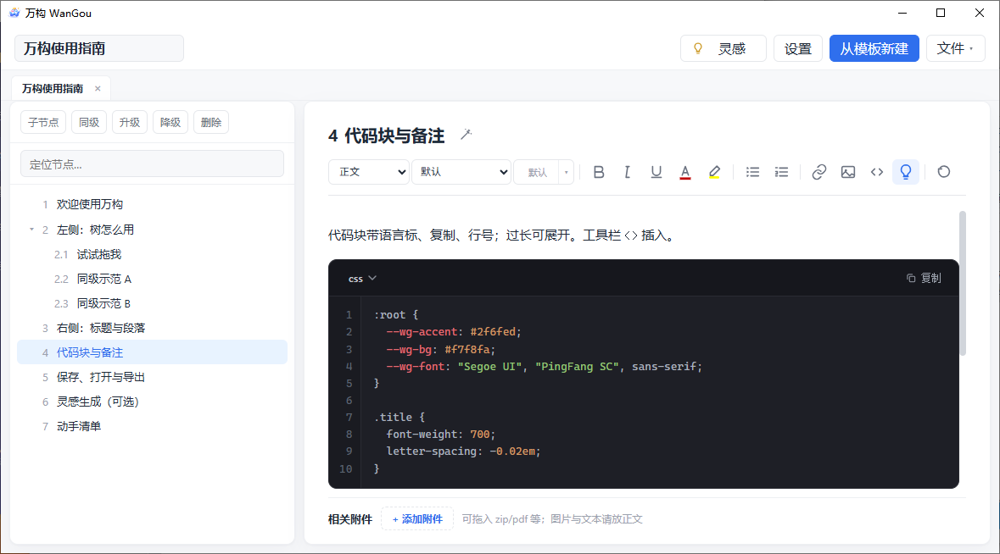
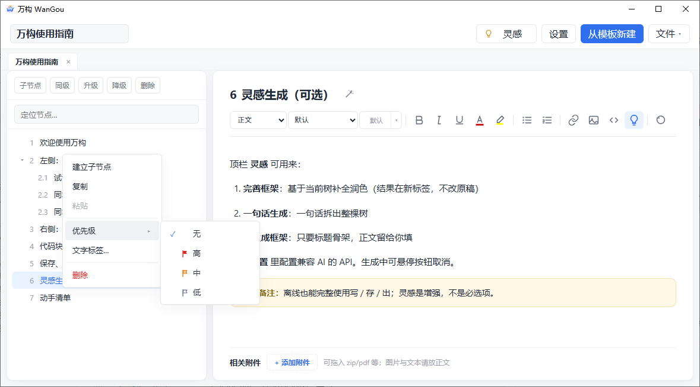
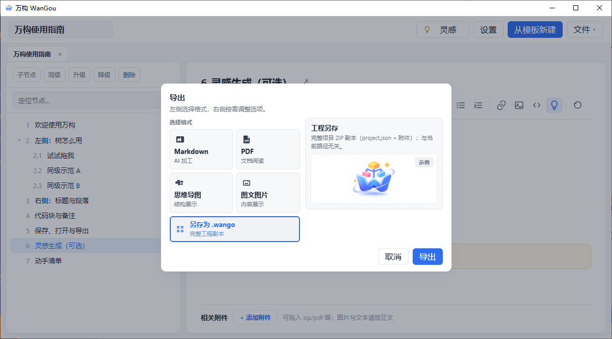
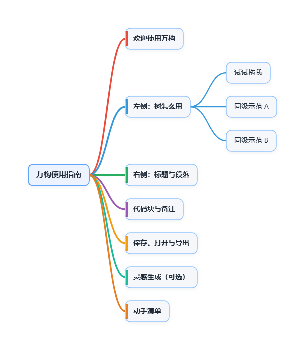
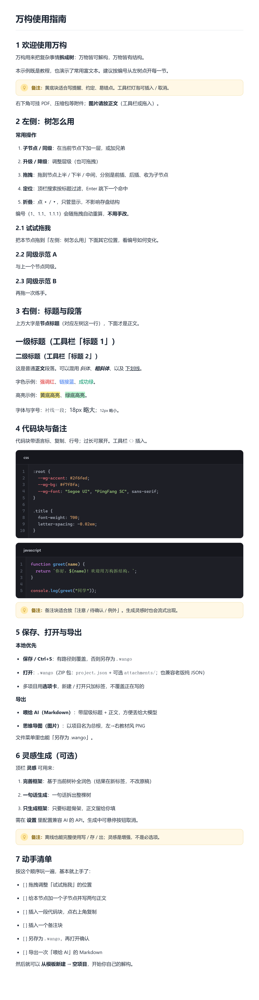
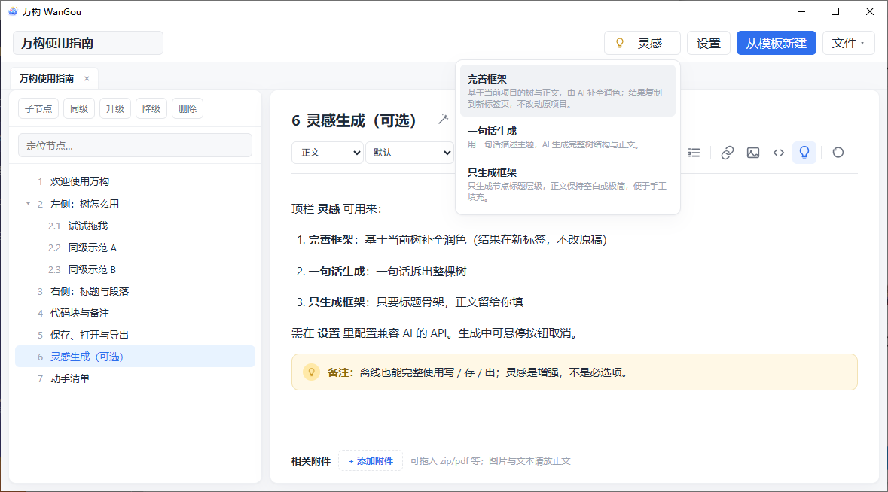
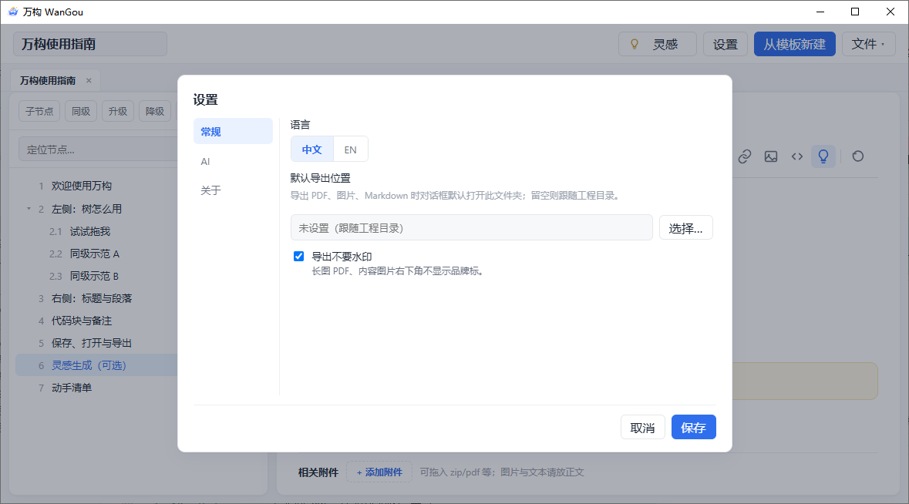

# WanGou · 万构

English | [简体中文](./README.md)

A **local-first** tree-structured writing & knowledge-decomposition workstation.  
Organize with a tree, write details in rich text, export for humans or AI — and optionally use OpenAI-compatible APIs for **Inspiration** generation.

Version **0.3.37** · Windows desktop (Tauri) · [Apache-2.0](./LICENSE)

<p align="center">
  
</p>

---

## Why WanGou

- **Tree for structure, editor for detail** — more than short mind-map labels; clearer hierarchy than a sprawling Word doc  
- **One `.wango` file carries everything** — ZIP pack (tree + body + attachments), double-click to open  
- **Write / save / export offline** — Inspiration is optional, not a gate  
- **UI in Chinese & English** — switch in Settings  

---

## Screenshots

### Home

Open a project, start empty, or learn from the sample guide. Drop a `.wango` file to open.


### Workspace

Left: infinite tree (numbering, drag-and-drop, priority / labels). Right: rich text + attachments.


### Rich text

Headings, colors & highlight, lists, links, images, code blocks (language / line numbers / copy), callouts.



### Tree actions

Context menu: add child, copy / paste, priority (submenu), labels, delete. Left-click selects; right-click opens the menu without swapping the editor body.



### Export

Markdown (for AI), PDF, mind map, content images, full `.wango` copy.



| Mind map | Long image / PDF |
| :--- | :--- |
|  |  |

### Inspiration (optional)

Refine framework · Generate from one sentence · Outline only. Configure an OpenAI-compatible API in Settings; keys stay on device.



### Settings

Language, model endpoint, default export folder, about / version.



---

## Feature summary

| Area | Highlights |
|------|------------|
| Projects | `.wango` ZIP · open / save / save-as · multi-tab · recents · single instance |
| Tree | CRUD, promote / demote, drag-drop, search, priority, labels |
| Editor | TipTap rich text · code blocks · callouts · images · attachments |
| Export | Markdown · mind-map PNG · long PDF / images · `.wango` copy |
| AI | Three Inspiration modes (optional) · keys stored locally |
| i18n | Chinese / English |

Details: [FEATURES.en.md](./FEATURES.en.md) · [中文功能说明](./功能说明.md)

---

## Quick start

### Prebuilt exe

1. Run `wango.exe` (Win10/11 usually include WebView2)  
2. If Defender warns on an unsigned build, choose **Run anyway**  
3. Open **Getting started (sample)** first  

Typical release artifact after a local build:

`src-tauri/target/release/wango.exe`

### From source

Requires **Node 18+**, **Rust**, and **VS Build Tools (C++)** on Windows.

```bash
npm install
npm test
npm run dev           # frontend only
npm run tauri:dev     # desktop
npm run tauri:build   # portable exe (no installer)
```

---

## Docs

| Doc | Description |
|-----|-------------|
| [FEATURES.en.md](./FEATURES.en.md) | Feature reference (English) |
| [功能说明.md](./功能说明.md) | Feature reference (Chinese) |
| [CHANGELOG.md](./CHANGELOG.md) | Release notes |
| [LICENSE](./LICENSE) | Apache License 2.0 |

---

## Conventions (contributors)

- `domain` / `io` / `export` must **not** depend on UI  
- Prefer Chinese code comments in this repo  
- User-facing strings live in `src/i18n` (`zh-CN` / `en` in pairs)  

---

## License

[Apache License 2.0](./LICENSE)
