# 万构 · WanGou

[English](./README.en.md) | 简体中文

**本地优先**的树状架构 / 知识解构工作台。  
用树拆结构，用富文本写细节，导出给人或 AI；可选接入兼容 OpenAI 的接口做「灵感」生成。

当前版本 **0.3.39** · Windows 桌面端（Tauri）· [Apache-2.0](./LICENSE)

<p align="center">
  
</p>

---

## 为什么是万构

- **树管结构，正文管细节** — 不像导图只能写短词，也不像 Word 容易乱层级  
- **一个 `.wango` 文件带走一切** — ZIP 封装（树 + 正文 + 附件），双击打开  
- **离线就能写 / 存 / 出** — AI「灵感」是增强，不是门槛  
- **界面中英双语** — 设置里一键切换  

---

## 界面一览

### 首页

打开项目、空项目，或从「使用指南（示例）」上手；支持拖入 `.wango`。


### 工作区

左侧无限层级树（编号、拖拽、优先级 / 标签），右侧富文本 + 附件栏。


### 富文本

标题 / 段落、颜色与荧光笔、列表、链接、图片、代码块（语言 / 行号 / 复制）、备注块。

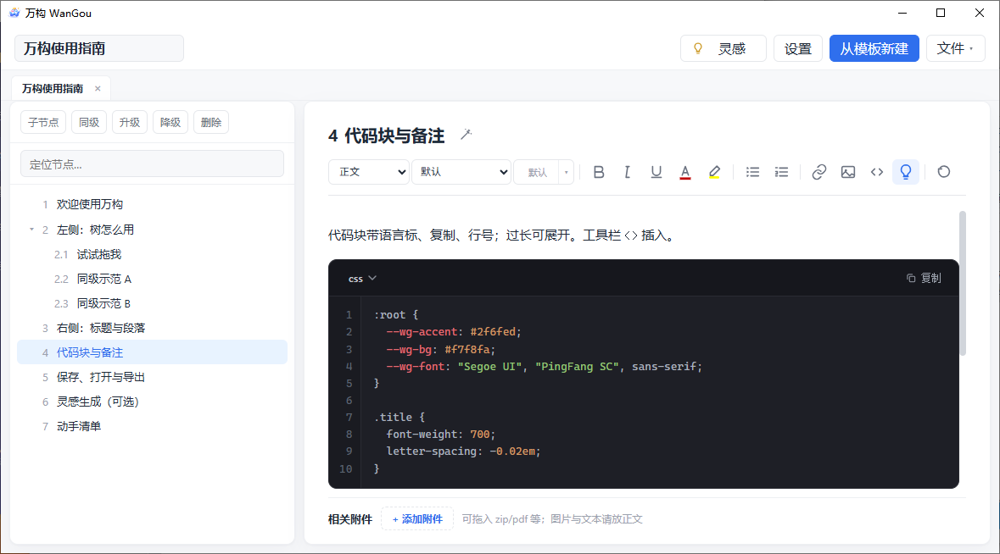

### 树操作

右键：子节点、复制 / 粘贴、优先级（二级菜单）、文字标签、删除。左键进入节点；右键只开菜单，不打断当前正文。

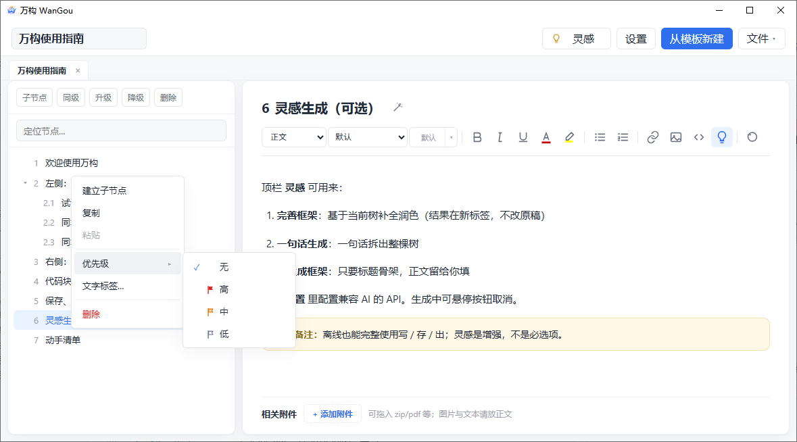

### 从粘贴 / 从文件新建

粘贴带序号的大纲，或导入 `.docx` / `.md`，预览后新开项目。

| 从粘贴新建 | 从文件新建 |
| :--- | :--- |
| 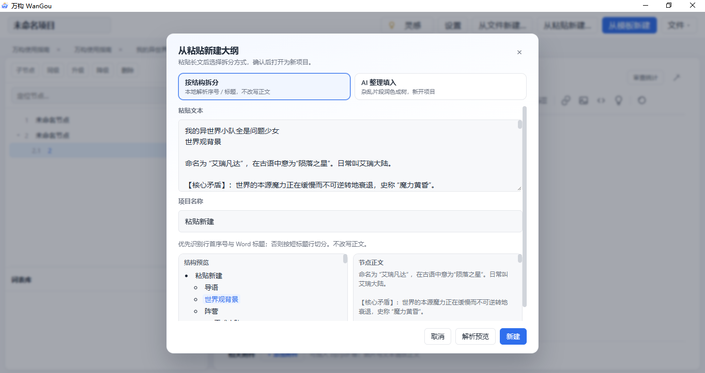 | 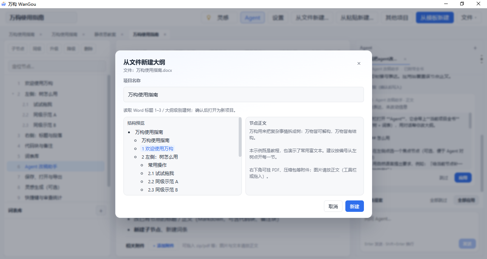 |

### 词表

左下词表库：引用 / 复制大纲为词条，正文扫链与绑定。

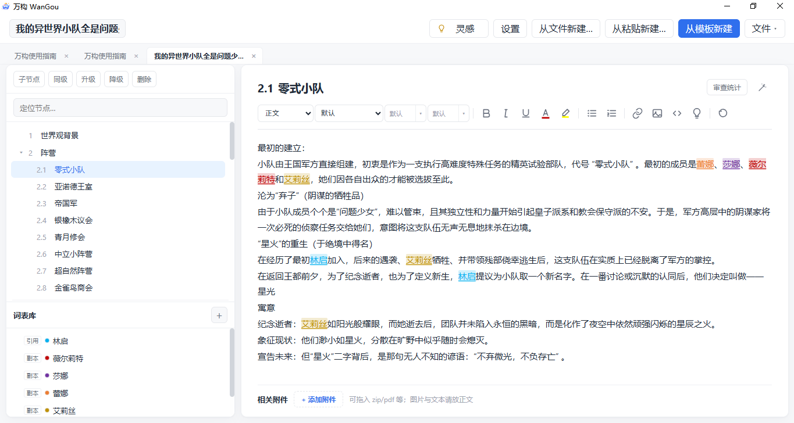

### Agent（可选）

全书上下文对话；改稿提案需确认后写入；多对话标签；输入框上方可「全部应用」。

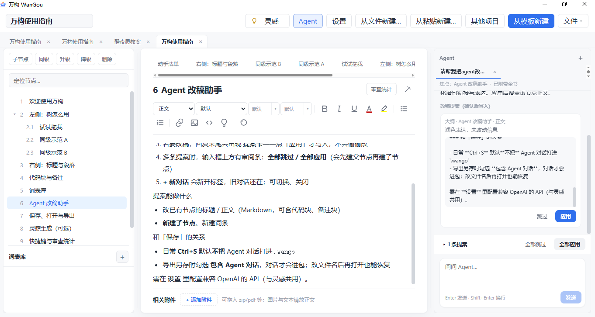

### 导出

Markdown（喂 AI）、PDF、思维导图、图文图片、另存完整 `.wango`（可选包含 Agent 对话）。

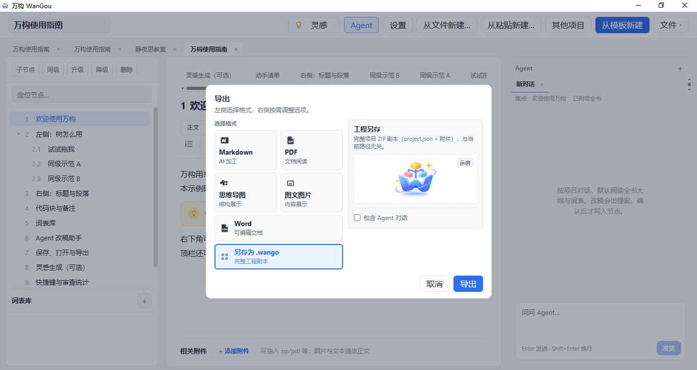

| 思维导图成品 | 长图 / PDF 一瞥 |
| :--- | :--- |
| 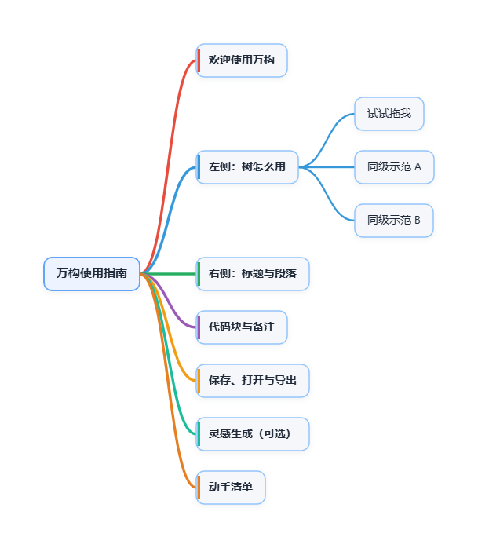 | 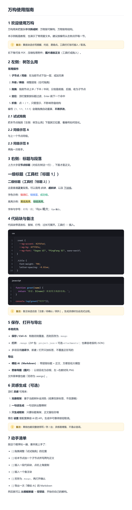 |

### 灵感（可选）

完善框架 · 一句话生成 · 只生成框架。需在设置中配置兼容 OpenAI 的 API；密钥只存本机。

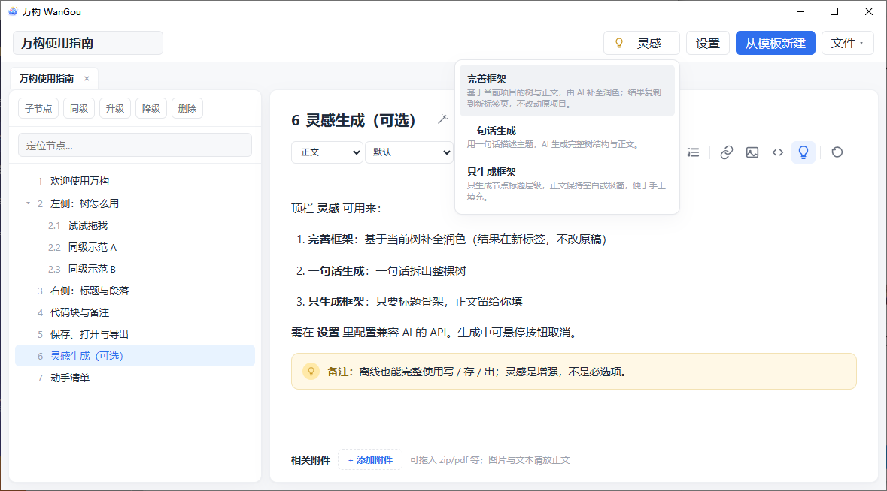

### 设置与效率

语言、模型服务、导出目录、**快捷键**；审查统计（F10）。

| 快捷键 | 审查统计 |
| :--- | :--- |
| 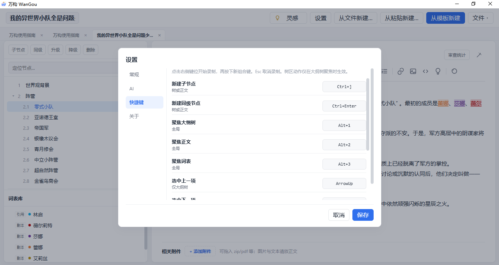 | 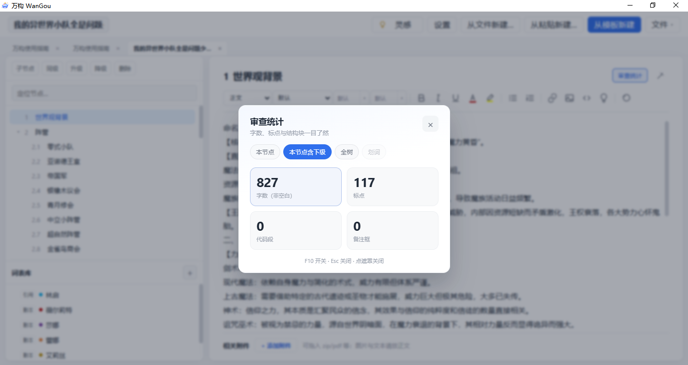 |

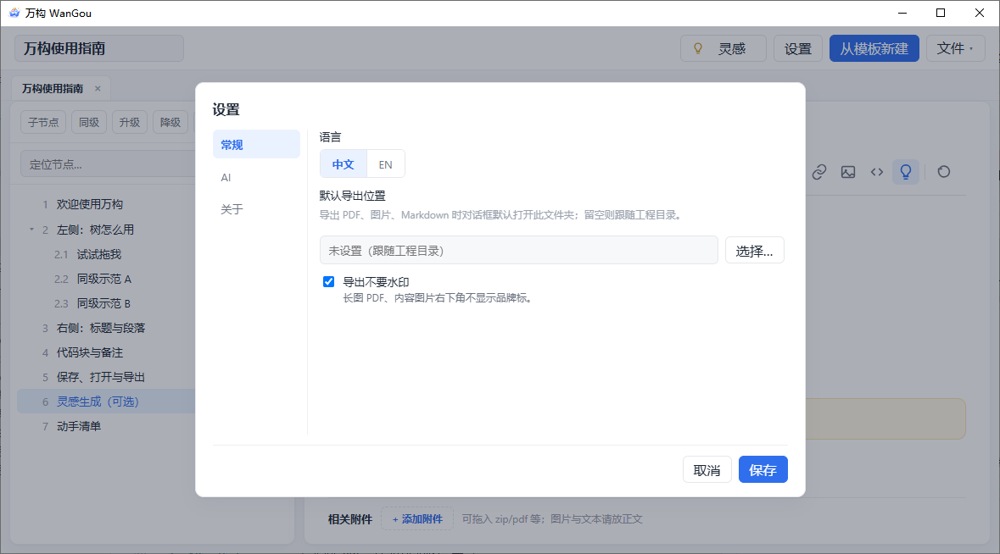

---

## 功能摘要

| 能力 | 说明 |
|------|------|
| 项目 | `.wango` ZIP · 打开 / 保存 / 另存 · 多标签 · 最近项目 · 单实例 |
| 新建 | 从模板 · **从粘贴新建** · **从文件新建**（`.docx` / `.md`） |
| 树 | 增删改、升降级、拖拽、搜索、优先级、标签、释放/解散子树 |
| 词表 | 引用/复制为词条 · 扫链 · 黑名单 · 改名说明 |
| 正文 | TipTap 富文本 · 代码块 · 备注 · 图片 · 行距 · 附件栏 |
| 导出 | Markdown · Word · 思维导图 PNG · 长图 PDF / 图片 · `.wango` 副本 |
| AI | **Agent** 改稿提案 · 灵感三模式 · 粘贴 AI 整理 · 密钥本机保存 |
| 效率 | 可配置快捷键 · 审查统计（F10） · 已打开页签 |
| 语言 | 中文 / English |

更完整的说明：[功能说明.md](./功能说明.md) · [English features](./FEATURES.en.md)

---

## 快速开始

### 使用已构建的 exe

1. 运行 `wango.exe`（Win10/11 一般自带 WebView2）  
2. 未签名时若被 Defender 拦截，选「仍要运行」  
3. 建议先打开 **使用指南（示例）** 熟悉树与正文  

开发机构建产物通常在：

`src-tauri/target/release/wango.exe`

### 从源码开发

依赖：**Node 18+**、**Rust**、Windows 上的 **VS Build Tools（C++）**。

```bash
npm install
npm test
npm run dev           # 仅前端预览
npm run tauri:dev     # 桌面端调试
npm run tauri:build   # 绿色 exe（无安装包）
```

---

## 文档

| 文档 | 说明 |
|------|------|
| [功能说明.md](./功能说明.md) | 功能详解（中文） |
| [FEATURES.en.md](./FEATURES.en.md) | Features (English) |
| [CHANGELOG.md](./CHANGELOG.md) | 版本变更 |
| [LICENSE](./LICENSE) | Apache License 2.0 |

---

## 设计约定（给贡献者）

- `domain` / `io` / `export` **不依赖** UI  
- 代码注释以中文为主  
- 应用内文案走 `src/i18n`（`zh-CN` / `en` 成对维护）  

---

## 许可证

[Apache License 2.0](./LICENSE)
